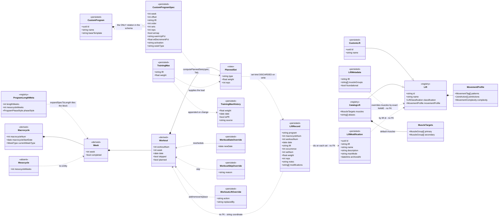

# Training Domain Model

**Status:** Active — descriptive. This documents the model **as built**, not a target state.
**Verified against:** `main` @ 2026-09-22. Counts and citations below were checked at that
point; re-verify before relying on one in an argument. CI-enforcing the mechanically
derivable ones is tracked in
[#1012](https://github.com/merickvaughn/lifting-logbook/issues/1012).

> **The one thing to know.** The ladder is
> `Program → Macrocycle → Mesocycle → Week → Workout → Lift slot → Set`, and **only the leaf is a row.**
> `LiftRecord` carries the whole `(program, macrocycleNum, workoutNum, date, lift, occurrence, setNum)`
> coordinate; every level above it is recomputed per request from the program spec plus a
> handful of override rows. Section 1 explains why; if you only need the model, start at
> section 3.

## Contents

1. [Why the model is shaped this way](#1-why-the-model-is-shaped-this-way)
2. [The lift taxonomy](#2-the-lift-taxonomy)
3. [The training-structure taxonomy](#3-the-training-structure-taxonomy)
4. [Prescribed vs. logged](#4-prescribed-vs-logged)
5. [Class diagram](#5-class-diagram)
6. [Known divergences](#6-known-divergences)

This repo has no single file you can read to learn what a workout *is*. The answer is
spread across `packages/types/src/domain.ts` (the lift taxonomy),
`packages/types/src/api.ts` (the structural hierarchy, as transport DTOs),
[`packages/core/src/presets/programLengths.ts`](../packages/core/src/presets/programLengths.ts)
(program length and periodization), [`apps/web/lib/workoutPlan.ts`](../apps/web/lib/workoutPlan.ts)
(the week/workout/set view models), and
[`apps/api/prisma/schema.prisma`](../apps/api/prisma/schema.prisma) (what is actually
stored). This document states the model in one place and — more importantly — marks
which parts of it are **rows** and which are **recomputed on every request**.

There are two taxonomies here, modeled in opposite ways.

---

## 1. Why the model is shaped this way

`packages/core` began as the domain layer of a Google Apps Script logbook that read
and wrote workout grids in Google Sheets. The grid builders and sheet mappers were
archived on 2026-09-04 ([#979](https://github.com/merickvaughn/lifting-logbook/issues/979),
see [`archive/`](../archive)), but the shape they implied survived — and
[`packages/core/src/constants/schema.ts`](../packages/core/src/constants/schema.ts)
still holds the original column headers verbatim:

| Sheet | Columns |
|---|---|
| `LiftRecord` | `Program`, `Macrocycle #` (legacy `Cycle #` accepted), `Workout #`, `Date`, `Lift`, `Set #`, `Weight`, `Reps`, `Notes` |
| `TrainingMax` | `Date Updated`, `Lift`, `Weight` |
| `LiftingProgramSpec` | `Week`, `Offset`, `Lift`, `Increment`, `Order`, `Sets`, `Reps`, `AMRAP?`, `Warm-Up %`, `WT Decrement %`, `Activation`, `Week Type` |

That is the whole model: **one prescription table and one log table, joined by integer
coordinates.** Reading the rest of this document with that in mind explains most of
what would otherwise look like an omission — the structural levels are spreadsheet
*columns*, so they never became objects.

---

## 2. The lift taxonomy

A **lift** is any named movement a user trains and logs, accessories included; the UI never
says "exercise" ([glossary.md → Lift](glossary.md#lift)).

This half is modeled deliberately and well. `packages/types/src/domain.ts` defines
**four orthogonal axes**, and the source comments state the orthogonality explicitly:

| Axis | Type | Values | Describes |
|---|---|---|---|
| Role | `LiftClassification` | `compound` \| `accessory` | Its job in the program |
| Pattern | `MovementProfile.patterns: MovementTag[]` | `push`, `pull`, `vertical`, `horizontal`, `hinge`, `carry`, `squat` | Kinesiological pattern |
| Joint action | `MovementProfile.jointActions: JointAction[]` | `flexion`, `extension`, `internal-rotation`, `external-rotation`, `abduction`, `adduction` | What the joints do |
| Complexity | `MovementProfile.complexity` | `simple` \| `compound` | Single- vs multi-joint mechanics |

Pattern tags **combine** rather than enumerate: `push + vertical` is the overhead-press
pattern, `pull + horizontal` is the row pattern. **Vertical and horizontal are measured relative
to the torso**, not the floor ([ADR-036](adr/ADR-036-muscle-group-defaults-and-fractional-set-counts.md)).
So a bench press is a horizontal push even though the lifter lies down, and a dip is a vertical
push because the hands drive down along the torso. An upright row is a vertical pull. Incline
pressing stays horizontal: at 45° or less it presses at least as close to perpendicular to the
torso as to parallel, and what it mainly changes is chest emphasis.

Role and complexity are the pair most easily confused, and `domain.ts` calls this out
directly: a **Goblet Squat is movement-`compound`** (knees and hips) **yet
role-`accessory`**. The two axes are independent and must stay that way.

[`packages/core/src/catalog/lifts.ts`](../packages/core/src/catalog/lifts.ts) carries all
four axes for **23 of the 26 built-in lifts**, grouped by pattern with a trailing accessories
group. Three leave one axis deliberately empty:
- `farmers-carry` has no `jointActions`. A loaded carry has no prime mover driven through a range
  of motion, and the source comment says so explicitly.
- `calf-raise` and `lateral-raise` have no `patterns`. A raise neither pushes nor pulls.

The curls (`cable-curl`, `leg-curl`) keep a lone `pull` tag, since they flex a joint toward the
body, but no direction. So neither a raise nor a curl earns a push/pull direction row.

`isBodyweightComponent` marks the three where body weight contributes to the load (dip, chin-up,
pull-up).

### A fifth axis: muscle groups, defaulted in the catalog, overridden per user

Every catalog entry is a `CatalogLift`: a `Lift` plus `muscles: MuscleTargets`. That field holds
**default** `primary` and `secondary` muscle groups from the 17-name `MUSCLE_GROUPS` vocabulary in
`packages/types`. Weekly set counts credit 1 per primary and ½ per secondary
([ADR-036](adr/ADR-036-muscle-group-defaults-and-fractional-set-counts.md)). The shared `Lift` type
does not carry muscles: a custom lift under its own name has no defaults, and the API never
returns catalog muscles.

Per-user overrides still live in `LiftMetadata` (`muscleGroups`, `substitutions`, `foundational`).
That is a **separate per-user table keyed by lift *name***, while `CustomLift` is keyed by uuid.
- An override on an exact lift name replaces the defaults for that name. Overrides do not follow
  aliases: one on "Squat" leaves "Back Squat" on its defaults.
- An empty list means "use the defaults".
- `muscleGroups` is still an unconstrained `String[]`. Readers canonicalize it
  case-insensitively against the vocabulary and keep unknown text as its own row
  (`buildMuscleTargetResolver`, `packages/core/src/catalog/muscles.ts`).
- Per-user lift attributes still live in two unrelated stores under two different keys. That is why
  a custom-lift rename orphans its overrides (D3).

### Modifications change how a lift is performed

A **modification** is a user-defined change to how a lift is performed, such as Wide grip on Cable
Curl. The set stays a set of that lift, and records which modifications were on. An alternative name
(`OH Press-HV`) is the same lift performed the same way and stores nothing new; a substitution is a
different lift ([#1133](https://github.com/merickvaughn/lifting-logbook/issues/1133)). See the
[proposal](proposals/2026-11-05-lift-modifications.md) and
[ADR-041](adr/ADR-041-lift-modification-storage.md).

- `lift_modification` holds them per user, unique on `(userId, lift, name)`. `lift` is a catalog id or
  a custom lift's uuid, written through `lookupLift`, with no foreign key because catalog lifts aren't
  rows. `maxMode` is `none`, `lift` or `own`: what it does to training maxes. Nothing reads `maxMode`
  yet except the rule below, because progression changes in
  [#1152](https://github.com/merickvaughn/lifting-logbook/issues/1152) and
  [#1153](https://github.com/merickvaughn/lifting-logbook/issues/1153).
- `lift_record.modifications` holds the ids on for a set, and isn't part of its natural key or id.
  Writes check that each id belongs to the user and the set's lift, with at most one `own`
  (`assertSetModifications`). `LiftRecordResponse` and `SetResponse` name each as `{ id, name }`.
- Delete removes a modification no set names, and otherwise archives it: gone from the list, still
  named on those sets. Creating its name again brings the same row back.
- The routes are under `/lifts/modifications`. The logger doesn't use them yet.

### Two name registries, one bridge

| Registry | Count | Purpose |
|---|---|---|
| `LIFT_NAMES` (`domain.ts`) | 12 | Autocomplete / onboarding fallback |
| `LIFT_CATALOG` (`core/catalog/lifts.ts`) | 39 | The real catalog: the four axes plus default muscles |
| `CatalogLift.aliases` (per entry) | 5 | Names that are neither catalog nor slot names: four that presets use (`Weighted Pull-ups`, `Incline DB Press`, `Calf Raises`, `Lateral Raises`), and `Flat Bench Press` |

They share 7 names exactly and diverge on 5 — `Squat`/`Back Squat`, `Dips`/`Dip`,
`Face Pulls`/`Face Pull`, `Cable Curls`/`Cable Curl`, `Cable Lat Raise`/`Lateral Raise`.
`DEFAULT_SLOT_MAP` (32 alias keys, [`core/catalog/slotMaps.ts`](../packages/core/src/catalog/slotMaps.ts))
is the reconciliation layer and resolves all of them for import. The onboarding
fallback in `apps/web/app/(authed)/onboarding/page.tsx` renders raw `LIFT_NAMES`
strings **without** passing through that bridge.

`builtInLiftFor(name)` (`core/catalog/builtInLift.ts`) is the one lookup that accepts every form a
built-in goes by:
- catalog display name;
- catalog id;
- per-entry alias;
- slot name.

Lift classification, default muscles and movement patterns all resolve through it. The per-entry
aliases are deliberately **not** in `DEFAULT_SLOT_MAP`. That map also drives the logger's
bodyweight detection, import validation and the custom-lift collision guard, and aliasing
`Weighted Pull-ups` there would flip it to a bodyweight-component lift. Those are separate
decisions, tracked in [#1015](https://github.com/merickvaughn/lifting-logbook/issues/1015).

Import also accepts every catalog display name and id, through `buildImportSlotMap`, without adding
them to `DEFAULT_SLOT_MAP` ([#1116](https://github.com/merickvaughn/lifting-logbook/issues/1116)).
Precedence is `DEFAULT_SLOT_MAP`, then the user's custom lifts, then the catalog. A catalog lift
outside `DEFAULT_SLOT_MAP` is stored under its **display name**, the string a program's `lift` holds
and the one training maxes and history are matched against. A `DEFAULT_SLOT_MAP` key still stores
its catalog id. That id does not match a program's display name, so those rows don't join by exact
string ([#1118](https://github.com/merickvaughn/lifting-logbook/issues/1118)).

Import accepts the per-entry aliases too, stored **as written**, because a preset's plan and training
maxes match on that string and Download My Data has to bring those rows back
([#947](https://github.com/merickvaughn/lifting-logbook/issues/947)). A set already logged under
another spelling of the lift, or listed under one earlier in the same file
([#1191](https://github.com/merickvaughn/lifting-logbook/issues/1191)), counts as a duplicate when
weight and reps also match, so re-importing a file doesn't double it. Weight and reps have to match
because one day can hold `Pull-up` and `Weighted Pull-ups` as two slots of the catalog's `pull-up`.

Every schema column references a lift by **name string**, not by `Lift.id` — see divergence
D3. But the column is not single-vocabulary: the import path can persist a canonical
catalog or custom-lift **id** into that same column when a row is pre-resolved through
`liftOverrides`, which is why `DEFAULT_SLOT_MAP` self-maps canonical ids and why
[`catalog/builtInLift.ts`](../packages/core/src/catalog/builtInLift.ts) opens by stating that
four forms reach its lookup — slot names, catalog names, catalog ids and per-entry aliases.
Import can also store a custom lift's **uuid**, which is why `lookupLift` matches custom lifts
by name *or* id. Code reading a `lift` value must tolerate all of these. To compare two of them,
use the helpers in [`catalog/liftIdentity.ts`](../packages/core/src/catalog/liftIdentity.ts), not
`===`. `lookupByLift` and `currentMaxLookup` cross any two spellings, for what a lift has one of.
`lookupByStoredId` and `storedIdListing` cross only through the catalog id, for what a user sets per
name (strength goals, timer overrides, muscle overrides) and for listing or totalling history (history
pages, focus block summaries), so two names a program plans separately stay apart
([#1135](https://github.com/merickvaughn/lifting-logbook/issues/1135)).
A query by lift expands through `liftSpellings`. Focus picks and trims stay exact, because only the
pool's own names reach them. `OH Press-HV` is the same lift
as `OH Press`; a lighter slot's load is [#1141](https://github.com/merickvaughn/lifting-logbook/issues/1141).
The helpers take no custom lifts, so a custom lift named after a catalog name compares equal to the
built-in until the resolver in [#1134](https://github.com/merickvaughn/lifting-logbook/issues/1134).
Import still stores the 12 `DEFAULT_SLOT_MAP` lifts by id.

When a name belongs to both a built-in and one of the user's custom lifts, `lookupLift` settles
it. A **reserved** name (a `DEFAULT_SLOT_MAP` slot name, which the custom-lift guard refuses)
always means the built-in. Any other name prefers the custom lift, whose classification and
patterns the user recorded. Default muscles are the one exception: they attach to the *name*, so
a same-named custom lift reads them until it is overridden.

---

## 3. The training-structure taxonomy

The conceptual ladder is:

```
Program → Macrocycle → Mesocycle → Week → Workout → Lift slot → Set
```

The names follow periodization vocabulary ([ADR-038](adr/ADR-038-training-time-vocabulary.md)): a
**macrocycle** is one full run through a program, a **mesocycle** ("block" in UI labels) is the
repeating unit of weeks, and a week is a microcycle. Lifting writing uses "cycle" for both of the
first two; [glossary.md](glossary.md) maps the overloaded terms.

Only the leaf is a row. `LiftRecord` carries the **entire coordinate** on every logged
set, and each level above it is reassembled per request.

| Level | Represented as | Stored? |
|---|---|---|
| **Program** | `string` id, plus `ProgramLengthMeta {lengthWeeks, mesocycleWeeks, phaseStyle}` | Registry for built-ins; `custom_program` row for user programs |
| **Macrocycle** | `macrocycleNum: number`, denormalized onto five child tables | `macrocycle_dashboard` is `@@unique([userId, program])` — **one row, the current macrocycle only** |
| **Mesocycle** (Block) | `mesocycleWeeks` arithmetic + `phaseStyle: 'repeating' \| 'mesocycle'` | **No entity.** A mesocycle boundary is `ceil(week / mesocycleWeeks)` |
| **Week** | `week: number` + `WeekType` | **Derived** by tiling (`expandSpecToLength`) |
| **Workout** | `(program, macrocycleNum, workoutNum)`; `workoutNum` is a **global ordinal** over the macrocycle, from `programWorkoutKeys`, with or without a schedule | **Derived.** Typed exactly once, as `TimerWorkoutKey` |
| **Lift slot** | spec row keyed `(week, offset, lift, order)` | `custom_program_spec` row |
| **Set** | `PlannedSet` (prescribed) / `LiftRecord` (logged) | One `lift_record` row per completed set |

`offset` is the day-within-week slot; `order` is the position within that day.

### Programs are one mesocycle, tiled

A stored spec holds **one repeating mesocycle** (block), expanded to the full program length at read
time — never in storage, so reverting is a pure code change.

| Program | Macrocycle length | Mesocycle | Style |
|---|---|---|---|
| `leangains` | 12 wk | 1 wk | `repeating` (autoregulated, AMRAP-driven) |
| `rpt` | 8 wk | 1 wk | `repeating` |
| `5-3-1` | 12 wk | 3 wk | `mesocycle` (4 mesocycles) |

`programLengths.ts` owns the canonical mapping and the helpers that keep the web grid
and the API in lockstep: `expandSpecToLength`, `mesocycleWeekForProgramWeek`,
`programWorkoutKeys` (the `workoutNum ↔ (week, offset)` mapping: the tiled program's
distinct days, in week-then-offset order), `noScheduleWorkoutDateUTC`, and `specRowsForWorkoutDay` (one workout day's rows: the
block week its program week tiles from, at its `offset`). A workout carries its
**program** week, but the spec endpoint serves the untiled block, so a lookup must go
through the block week and the day's offset. `WorkoutResponse` carries the `offset` for
that reason (#1014).

> **Three registries must agree:** `PRESET_BASE_SPECS`, `PROGRAM_LENGTHS`, and
> `apps/api`'s `PROGRAM_DEFAULTS`. `programLengths.test.ts` holds the reciprocal guard.

### Overrides stand in for the missing Workout row

Because no workout row exists, an instance diverges from its template through
side-tables keyed `(userId, program, macrocycleNum, workoutNum)`:

| Table | Purpose |
|---|---|
| `workout_date_override` | Rescheduled to a new date |
| `workout_skip_override` | Explicitly skipped |
| `workout_lift_override` | `action: add \| remove \| replace` (+ `replacedBy`) |
| `macrocycle_scheduled_workout` | The generated schedule: one date per program day, in the program's order (no HTTP route at all). A schedule dates workouts and never numbers them, so readers take a workout's week and day from its `workoutNum` ([ADR-037](adr/ADR-037-schedule-dates-program-days.md)) |

This is the clearest structural evidence of the absent entity: three tables exist to
describe changes to a thing that is not itself stored.

**A `replace` swaps the movement, not the slot.** On the workout pages (detail, timer
and logger), the replacement keeps the slot's position and its logged sets: sets logged
under any earlier name of the slot, through a chain of swaps, are grouped under its
current lift. It also keeps the slot's prescription: sets, reps, AMRAP, warm-up and
decrement percentages, increment and activation. Only the weights change, because they
are priced from the replacement's own training max. `applyLiftOverrides`
(`packages/core`) is the one definition of these rules. It applies a workout's overrides
in the order each was last written, which is how the repositories return them (saving an
override again re-creates it at the end). A lift keeps one override of each kind — its
`add` or `remove`, and its `replace` — so replacing a lift added through Manage Lifts
keeps the add, and the replacement takes the added lift's place and sets (#1026). The
store keeps the add rather than `applyLiftOverrides` inferring it, because a replace of
a lift the plan doesn't show is routine once re-saves reorder a chain of swaps: treating
it as an add would list a lift twice when a chain is redone after an undo. The
workout response names the slot on the replacement's `replaces`, so clients resolve the
prescription without the override table (#1014). The step from a swap to a prescription
is `packages/core`'s `services/workout/dayPrescriptions.ts`. `plannedLiftRows` is the
page rule: a lift takes its own row in the day, or for a replacement the row of the slot
it `replaces`; the workout pages resolve a lift's prescription with it.
`resolveDayPrescriptions` applies a day's overrides and maps each stored lift name to its
row; the workout endpoint plans a day's lifts with it and `updateMaxes` resolves a logged
set's prescription with it, so the set progresses the replacement's own training max by
the slot's rules. It adds two rules only progression needs, since only progression sees
sets stored under names the plan no longer shows: sets logged under a slot's earlier name
take the slot's row, and a removed lift keeps its own row. Progression doesn't regroup
those sets: they progress their own lift's max (#1028).

A day can plan one lift twice: a superset, or extra volume after the hypertrophy work.
Each **occurrence** is its own slot. `plannedLiftRows` gives a lift's second slot its
second row, and the workout response lists the lift twice, the later entry carrying
`occurrence: 1`. A `LiftRecord`'s `occurrence` says which one a set was logged against,
from 0 (`liftOccurrences` numbers them in plan order), so each occurrence keeps its own
sets and its record id ends in `<setNum>~<occurrence>` past the first. Progression reads
only a lift's first occurrence: a later one has its own prescription and its own set 1
(#1027). Overrides still address a lift by name, so a swap replaces every occurrence of
it, and a duplicate that a swap or an add makes is not told apart from a planned one yet
(#1109).

### Focus blocks sit beside the ladder, not on it

A **focus block** ([#1053](https://github.com/merickvaughn/lifting-logbook/issues/1053)) is
accessory work for one muscle area over a calendar month or quarter. It is not a level of the
ladder: it runs on dates, not on `macrocycleNum`/`workoutNum`, so it carries on unchanged
when the program switches or a new macrocycle starts. It is always "focus block" in docs and
code; the bare word "block" is a mesocycle.

| Concept | Represented as | Stored? |
|---|---|---|
| **Focus block** | `FocusBlock` (`packages/types/src/focus.ts`): area, period, alignment, start date, lift pool, timer | One `focus_block` row. Pool and timer are JSON columns |
| **Focus block status** | `queued` \| `active` \| `ended`, from `blockStatus(block, today)` | **Derived** from the dates on every read, never stored ([ADR-039](adr/ADR-039-focus-block-persistence.md)) |
| **Focus block series** | `series` shared by a block and the auto-roll successors it creates | A column. A successor is a row created on read, idempotent on `(userId, series, start)` |
| **A workout's focus work** | `planFocusDay` over the active blocks and the workout's planned lifts | **Derived** per request; the user's per-workout choices are one `focus_day_state` row, keyed like the override side-tables |
| **Daily focus guide** | `FocusBudget {sets, minutes}` | Two nullable `user_settings` columns |

A focus block names its areas through `FOCUS_AREA_MUSCLES`, which maps each of the eight areas
onto `MUSCLE_GROUPS`; whether a planned lift overlaps one is decided by the muscle resolver
(§2), so a user's muscle overrides apply.

---

## 4. Prescribed vs. logged

The seam between plan and actual is crossed by **four set-shaped types**, and the
layering is deliberate — the dependency arrow points inward, so the web and timer
layers map into their own shapes rather than `packages/core` reaching outward:

| Type | Where | Role |
|---|---|---|
| `LiftingProgramSpec` | `packages/core/src/models` | The prescription row (sets, reps, percentages) |
| `PlannedSet` | `apps/web/lib/workoutPlan.ts` | Concrete weights, via `computePlannedSets(spec, trainingMax)`. Carries `type: 'warmup' \| 'work'` |
| `TimerSetPlan` | `packages/core/src/timer` | What the countdown needs. `type: 'warmup' \| 'work' \| 'activation'` |
| `SetResponse` / `LiftRecord` | API / DB | The logged set |

On the read side, `WorkoutLiftResponse.planned: boolean` is **the only discriminator**:
`true` means projected from the spec with nothing logged yet, `false` means backed by
real records.

**Set kind does not survive the write.** `lift_record` has no set-kind column, and
warm-up rows in the logger are display-only. Once logged, a warm-up set and a work set
are indistinguishable. Related: for a *logged* set, `amrap` is recovered by
string-matching the notes field (divergence D1).

### Progression

`updateMaxes` ([`core/src/services/maxes/updateMaxes.ts`](../packages/core/src/services/maxes/updateMaxes.ts))
branches on `WeekType`:

| `weekType` | Behavior |
|---|---|
| `training` | If set 1 met `spec.reps`, new TM = `weight + spec.increment` |
| `test` | Uses the final set; new TM = that weight, no increment |
| `deload` | No progression |

A computed *reduction* is never auto-applied — it is returned as a `MaxReductionFlag`
for explicit review. Note that no shipped preset ever sets `weekType`, so in practice
only the `training` branch runs (divergence D5).

---

## 5. Class diagram

Stereotypes carry the load here — they distinguish what is stored from what is
reassembled per request.

| Stereotype | Meaning |
|---|---|
| `«persisted»` | A real Prisma row |
| `«registry»` | A compile-time constant in `packages/core` |
| `«derived»` | Assembled per request; no storage |
| `«view»` | Exists only in the browser |
| `«absent»` | A training concept with no representation |



The four edges worth reading twice:

1. `LiftRecord ..> Workout` — **no foreign key.** The link is a string coordinate.
2. `CustomProgramSpec × TrainingMax ..> PlannedSet` — the prescription becomes concrete weights only at read time.
3. `PlannedSet ..> LiftRecord` — **set kind is discarded on write.**
4. `LiftMetadata ..> Lift` — still no foreign key. A per-user row keyed by exact lift **name**
   overrides a catalog lift's default muscles. It is also the *only* source of muscles for a
   custom lift, which is why renaming a custom lift orphans it (D3).

### What the database looks like

**19 models, 1 relation, 0 enums.** The sole relation is
`CustomProgram → CustomProgramSpec` (`onDelete: Cascade`). Every other model is a flat
table scoped by a bare `userId String`; there is no `User` model (Clerk owns identity)
and therefore almost nothing cascades.

Eleven exhaustive TypeScript unions — `WeekType`, `LiftClassification`, `MovementTag`,
`JointAction`, `MovementComplexity`, `WeightUnit`, `LiftOverrideAction`,
`TrainingMaxHistorySource`, `ImportKind`, `goalType`, `LiftModificationMaxMode` — are stored as
bare `String`. CHECK constraints exist on `training_max_history.source`, `strength_goal.unit`,
`body_weight.unit`, `lift_modification.maxMode`, and every enum column of `focus_block` (area, next area, period, alignment,
selection, overlap, progression, end behavior). `focus_block.pool`, `focus_block.timer` and
`focus_day_state.state` are JSON, validated by DTOs on write and re-parsed on read
([ADR-039](adr/ADR-039-focus-block-persistence.md)).

Row-level security is the real isolation boundary, and the invariant is that **every table in the
schema has it enabled and `FORCE`d, fail-closed** — `custom_program_spec`, which has no `userId`
column, is isolated by an `EXISTS` join to its parent instead. Policies are added by the migration
that creates each table, so they arrive across several migrations rather than one
(`20260611000000_enable_rls` established the pattern; `import_batch` and `body_weight` carry their
own). State it as the invariant rather than a tally: a count here drifts every time a table is
added, and a stale one implies some table is unprotected. Per
[#644](https://github.com/merickvaughn/lifting-logbook/issues/644) — where RLS was inert in
production for three weeks because every test ran as superuser — verify isolation-sensitive changes
under the restricted role, not the admin one.

---

## 6. Known divergences

Recorded, not fixed. Each item names its location so it can be triaged independently.
**[#987](https://github.com/merickvaughn/lifting-logbook/issues/987) already owns the
DTO/domain drift cluster** — the dropped `weekType` on `LiftingProgramSpecResponse`,
`CustomProgramSpecRow.weekType` widened to `string`, and the duplicate `ColumnMapping`
— and is not restated here.

**How this section is organised, and how to extend it.** *Defects* are wrong behaviour;
*Built but unreachable* is correct behaviour with no caller; *Contract and vocabulary
drift* is a representation mismatch with no user-visible defect. Where an item could sit
in two groups, it is filed under the one that determines who should pick it up.

**D-numbers are append-only.** They are the stable handle an issue or a PR cites, so a new
finding takes the next free number regardless of group, and a resolved one is struck
through with its closing PR rather than deleted or renumbered.

### Defects

| # | Finding | Location |
|---|---|---|
| **D1** | **Logged `amrap` is recovered by string-sniffing free text**: `amrap: r.notes.toUpperCase().includes('AMRAP')`. Any note mentioning "amrap" flips the flag. `amrap` is a real column on `custom_program_spec` but has none for a logged set. | `apps/api/src/programs/mappers.ts:346` |
| **D2** | ~~**`deleteCurrentMacrocycle` does not delete the workout overrides.** Its docstring opens "the current macrocycle … and every row scoped to it", then enumerates five kinds; the `repos` parameter's `Pick<>` type structurally excludes the rest. `workout_date_override`, `workout_skip_override` and `workout_lift_override` are all `(program, macrocycleNum, workoutNum)`-scoped and survive, so after delete-then-initialize the old macrocycle 1's reschedules, skips and lift overrides resurface on the new macrocycle 1. No FK cascade covers it.~~ Resolved in [PR #1088](https://github.com/merickvaughn/lifting-logbook/pull/1088) ([#1084](https://github.com/merickvaughn/lifting-logbook/issues/1084)): the delete now also removes the three override tables and `focus_day_state` (keyed the same way), for every macrocycle number, since re-initializing always starts again at macrocycle 1. (`strength_goal`, `body_weight`, focus blocks and the focus budget still survive, which is arguably correct — they outlive a macrocycle. `import_batch` survives with a `preImage` referencing deleted rows.) | ~~`apps/api/src/programs/macrocycle-generation.service.ts:288`~~ |
| **D3** | **Renaming a custom lift silently orphans its history.** `custom_lift.id` is the REST key, and `domain.ts` claims id is independent of name "so a lift can be renamed without breaking references" — but every training table keys lifts by name string, and `update()` writes only the `custom_lift` row. There is no `updateMany` in any repository. A rename leaves `lift_record`, `training_max`, `strength_goal`, `lift_metadata`, `workout_lift_override` and `custom_program_spec` pointing at the old name. | `apps/api/src/adapters/prisma/custom-lift.repository.ts:59` |
| **D4** | **A `LiftRecord`'s public id is unstable.** The cuid PK is never exposed; `LiftRecordResponse.id` is the synthetic composite `program-macrocycleNum-workoutNum-YYYYMMDD-lift-setNum` (`setNum~occurrence` past a lift's first occurrence, #1027), parsed back to the compound unique index on `PATCH`. Editing a record's date therefore changes its id. `packages/core`'s `LiftRecord` model declares no `id` field at all. | `packages/core/src/utils/import/liftRecordNaturalKey.ts:108` |
| **D5** | **`WeekType` drives progression, and no shipped preset sets it.** For built-in programs `weekType` is always `undefined` → `'training'`, so only one of `updateMaxes`' three branches runs. The `test` and `deload` branches are **not dead code**: a custom program can set `weekType`, and the create DTO accepts it as an unconstrained `@IsString()` — so an arbitrary string reaches a field the domain types as a three-value union. `apps/web/lib/programPlan.ts` notes its own `deload`/`test` phase branches are unreachable. `docs/PRD.md` lists deload as a v1.0 **non-goal**; the user guide and the in-app glossary used to describe it as routine and, since ADR-038, say no shipped program schedules one. | `packages/core/src/presets/index.ts`, `create-custom-program.dto.ts` (`weekType`) |
| **D6** | **`body_weight` is program-scoped with no uniqueness.** A weigh-in is a per-user fact, but scoping it by `program` makes it invisible after a program switch; duplicate same-day rows are legal; and the port exposes only `recordBodyWeight` + `getLatestBodyWeight`, so the accumulated series is write-only. | `apps/api/prisma/schema.prisma`, `IBodyWeightRepository` |

### Built but unreachable

| # | Finding | Location |
|---|---|---|
| **D7** | **The Macrocycle Planning Agent (ADR-016's "Cycle Planning Agent") has no UI.** ADR-016 is Accepted and the server side is complete — `IMacrocyclePlanningAgent`, two LLM adapters, six agent tools (`TOOL_DEFS` in `agent-tools.ts`), `POST /macrocycle-plan`, `MacrocyclePlanResponse`. `rg -l 'macrocycle-plan\|MacrocyclePlan' apps/web packages/api-client` returns **nothing**. `ProgramPhilosophy` is the same but thinner: a port, an adapter, three factory wirings, and no HTTP route at all. | `apps/api/src/programs/macrocycle-plan.controller.ts`, [ADR-016](adr/ADR-016-cycle-planning-agent.md) |
| **D8** | **`MovementProfile` is populated and unread.** The catalog carries patterns, joint actions and complexity; no *production* `apps/web` code reads them. All seven `apps/web` occurrences are non-production: six empty-array fixtures in two import test files, present to satisfy the type, plus one in the Playwright e2e mock (`e2e/mock-api.mjs`) that passes the field through rather than fixing it empty. `LiftEditor.tsx` edits only the thinner `LiftMetadata`. | `packages/core/src/catalog/lifts.ts` |
| **D9** | **Macrocycle is modeled as a sequence and exposed as a singleton.** `[macrocycleNum]` appears in every macrocycle-scoped authed URL (10 of the 22 authed routes), but the dashboard `notFound()`s unless it equals the current macrocycle, and `plan`/`program` redirect to current. There is no `/macrocycles/:macrocycleNum` resource and no `GET /macrocycles`. `createMacrocycle` is re-exported in `apps/web/lib/api.ts:84` and **never called** — finishing macrocycle 1 leaves no way to start macrocycle 2. `POST /training-maxes/recalculate` is likewise uncalled; its only mention in the web app is copy in `MaxHistory.tsx:82` describing a recalculation the user cannot trigger. | `apps/web/app/(authed)/macrocycle/[macrocycleNum]/page.tsx` |
| **D10** | **`WorkoutResponse.bodyWeightEntry` is declared and never populated** — one source reference repo-wide, the declaration itself. | `packages/types/src/api.ts:126` |
| **D11** | **Two unrelated strength-goal models.** `domain.ts`'s `StrengthGoal` (`StrengthTier`, `multiplierOverride`, `targetDate`, `observedDate`) and `StrengthStandard` have **no persistence and no API surface**; the persisted `StrengthGoalResponse` (`goalType: absolute \| relative`) has no tier concept. So "reach advanced by March" is unexpressible, even though the tier ladder and `evaluateStrengthTier` exist. | `packages/types/src/domain.ts:121-139` |
| **D12** | **The timer and the logger never meet.** Per [ADR-035](adr/ADR-035-client-side-rest-timer-state.md) the timer keeps all state in one `localStorage` key and **writes nothing** — no `createLiftRecord` under any timer directory — and links only back to `/detail`. A workout therefore has no duration, no RPE and no finished-at; the session's timing data is discarded. Timer settings also sit outside `UserSettings`, so they cannot sync across devices. | `apps/web/lib/useWorkoutTimer.ts`, `packages/core/src/timer` |

### Contract and vocabulary drift

| # | Finding | Location |
|---|---|---|
| **D13** | **A documented, deliberate contract narrowing, not a bug — but still an asymmetry.** `UpdateTrainingMaxesRequest.unit` is `'lbs' \| 'kg'` while the DTO pins `@IsIn(['lbs'])`, because `training_max` has no `unit` column and the author judged rejecting a value the server cannot honor safer than silently mislabeling 140 kg as 140 lbs. The reasoning is written out in full at the validator. Real per-entry unit storage is tracked separately. | `apps/api/src/programs/update-training-maxes.dto.ts:63-86` |
| **D14** | **`training_max_history` has no `macrocycleNum`**, and `macrocycle_dashboard` retains only the current macrocycle — so a TM change cannot be attributed to a macrocycle, and past macrocycle start dates are gone, so it cannot be reconstructed either. `reps` is persisted on the row and omitted from the response. | `apps/api/prisma/schema.prisma` |
| **D15** | **`WeekType` and `PhaseType` are identical unions declared independently**, in `packages/types/src/domain.ts` and `apps/web/lib/programPlan.ts`. | both files |
| **D16** | **`amrap` is `string \| boolean` in `packages/core`** but `boolean` at the API and in the DB, bridged by `normalizeAmrap()` — legacy CSV provenance leaking into the domain model. | `packages/core/src/models/LiftingProgramSpec.ts` |
| **D17** | **Two ports-and-adapters escapes, one resolved in [PR #1030](https://github.com/merickvaughn/lifting-logbook/pull/1030)** ([ADR-002](adr/ADR-002-ports-and-adapters.md)). `CustomProgramsRepository` — the richest aggregate in the schema — is a plain class in its feature folder, absent from `RepositoryBundle` and `tokens.ts`, with no in-memory twin; `SwitchProgramController`'s custom-program ownership check depends on this still being true (a UUID program id can only be a custom program, so with no database it treats "not found" and "not owned" the same way). ~~`UserSettingsRepository` also sits outside `adapters/prisma/` and exposes `upsertSettings()`, which its port does not declare.~~ Resolved in #1030: moved to `PrismaUserSettingsRepository` under `adapters/prisma/`, `upsertSettings()` added to the port and the in-memory adapter, and both `UserSettingsController` and `SwitchProgramController` now resolve it through `RepositoryBundle` instead of injecting `PrismaService` directly. | `apps/api/src/custom-programs/`, `apps/api/src/programs/switch-program.controller.ts`, ~~`apps/api/src/user-settings/`~~ |
| **D18** | ~~**"Lift" vs "Exercise" for one concept**, in adjacent screens. "Lift" dominates by roughly an order of magnitude on any counting method, but both are live: `<h3>Exercises</h3>` on the program page, `aria-label="Exercise navigation"` in the logger, and `ExerciseInstance` as the editor's own model type. The time-structure half of this gap is closed: the user guide, [glossary.md](glossary.md) and the in-app `/glossary` now define macrocycle, mesocycle (block), week and workout/session ([ADR-038](adr/ADR-038-training-time-vocabulary.md)). **Lift** still has no glossary entry.~~ Resolved in [#1045](https://github.com/merickvaughn/lifting-logbook/issues/1045) ([ADR-038 amendment](adr/ADR-038-training-time-vocabulary.md#amendment-lift-not-exercise-1045)). **Lift** is the one user-facing term, defined identically in all three glossaries, with "exercise" listed as a synonym. Every user-visible "exercise" now says "lift": UI copy, aria-labels, the import wizard, the logger, the program editor, the core import-validation messages and the API's reserved-name 409. `ExerciseInstance` is now `LiftInstance`. Kept on purpose: program catalog copy in `apps/web/lib/programs.ts`, which keeps each author's words (as ADR-038 does for "cycle"); a CSV's "Exercise" column header, which is input data mapped onto Lift; and code comments, CSS class names and internal identifiers no user sees. | ~~`apps/web`, `docs/user-guide.md`~~ |
| **D19** | **The program editor is the only nested model, and it is browser-only.** `WorkoutDayModel → LiftInstance → WeekParams` exists in React state and flattens to `CustomProgramSpecRow[]` on save (day index → `offset`, position → `order`). It also hard-codes `WEEKS = [1,2,3]`, matching the API DTO's `@IsIn([1,2,3])`, while the catalog advertises programs from 8 to 24 weeks — so a program of the length the app ships cannot be authored. "Day" is user-visible only here. | `apps/web/app/(authed)/programs/programSpecMapping.ts` |

---

## References

- [ADR-002 — Ports and adapters](adr/ADR-002-ports-and-adapters.md)
- [ADR-016 — Cycle planning agent](adr/ADR-016-cycle-planning-agent.md)
- [ADR-038 — Training-time vocabulary](adr/ADR-038-training-time-vocabulary.md)
- [ADR-017 — Training max history table](adr/ADR-017-training-max-history-table.md) — the one domain-model ADR, and fully surfaced
- [ADR-035 — Client-side rest timer state](adr/ADR-035-client-side-rest-timer-state.md)
- [ADR-037 — A schedule dates the program's workouts; it never numbers them](adr/ADR-037-schedule-dates-program-days.md)
- [`docs/README.md`](README.md) — architecture narrative and full ADR index
- [`docs/user-guide.md`](user-guide.md) — end-user vocabulary
- [`docs/standards/training-max-precision.md`](standards/training-max-precision.md) — rounding rules referenced by `computePlannedSets`
- Martin Fowler, [*Anemic Domain Model*](https://martinfowler.com/bliki/AnemicDomainModel.html) — the pattern §3 describes
- Eric Evans, *Domain-Driven Design* (Addison-Wesley, 2003), ch. 5–6 — entity vs. value object, and the aggregate boundary the override tables work around
